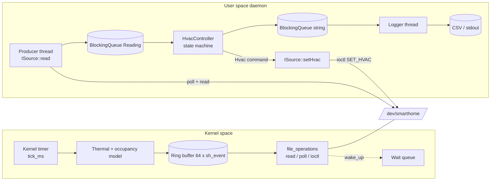
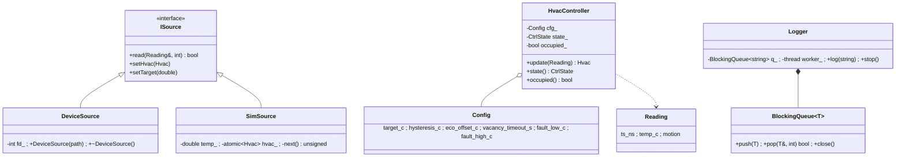
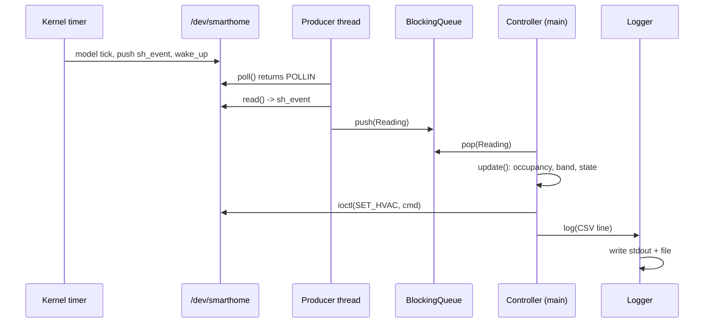
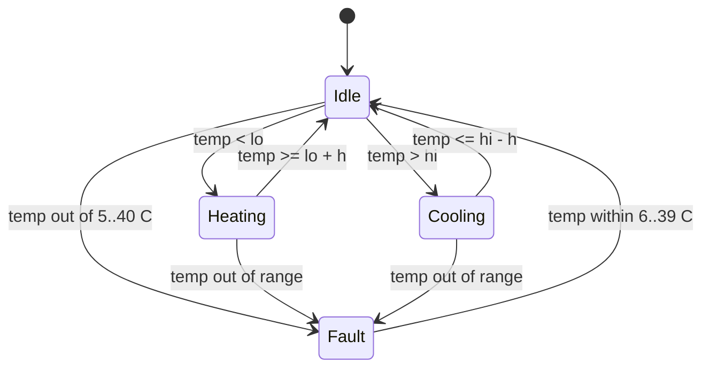

# Stage 3 - System Design & Architecture

## 1. Architecture


## 2. Components and responsibilities
| Component | Responsibility |
|---|---|
| Timer + model (kernel) | Advance temperature, occupancy; generate a sample per tick |
| Ring buffer (kernel) | Decouple timer (producer) from reader; overwrite oldest when full |
| `file_operations` | User interface: `read`, `poll`, `unlocked_ioctl` |
| `ISource` | Hides whether data comes from driver or simulator |
| `DeviceSource` | RAII wrapper of fd; poll/read/ioctl |
| `SimSource` | Same physics in user space (testing, demo without root) |
| `HvacController` | Occupancy inference, comfort/eco band, hysteresis, fault handling |
| `BlockingQueue<T>` | Thread-safe hand-off with timeout and close |
| `Logger` | Asynchronous output so control never waits on disk |

## 3. Data structures
```c
struct sh_event  { u64 ts_ns; s32 temp_mc; u8 motion; u8 hvac; u16 reserved; };   // 16 B, no hidden padding
struct sh_status { s32 temp_mc, outdoor_mc, target_mc; u8 hvac, occupied; u16 reserved; u32 dropped; };
```
Ring buffer: free-running `head`/`tail` counters, index `% 64`; full when `head - tail == 64`
(unsigned wrap-around safe). Thermal model per tick (milli-C):
`delta = (outdoor - temp)/50 (+300 heat | -300 cool) (+20 if occupied)`.

Controller thresholds: occupied band `[target-h, target+h]`, vacant `[target-eco, target+eco]`;
heat stops at `lo + h`, cooling stops at `hi - h`.

## 4. UML

### Class diagram


### Sequence diagram (one control cycle)


### State machine diagram

`lo`/`hi` depend on occupancy (comfort vs. eco band).

## 5. Implementation plan
1. Driver skeleton: load/unload, device node. 2. Ring buffer + timer. 3. read/poll. 4. ioctl.
5. Controller + unit tests. 6. DeviceSource/SimSource. 7. Threads/queue/logger. 8. Integration,
sanitizers, docs.

## 6. Development environment
Ubuntu 22.04/24.04 (VM recommended for kernel work), `build-essential`, `linux-headers-$(uname -r)`,
g++ >= 9 (C++17), `make`, `git`, `strace`, `gdb`, optional `valgrind`. Editor: VS Code / vim.

## 7. Git repository & branching
`main` (stable, tagged `stage-N`, `v1.0`) <- `develop` <- `feature/driver`, `feature/controller`,
`feature/logger`, `docs/report`. Conventional commits (`feat:`, `fix:`, `test:`, `docs:`);
merge feature -> develop via pull request; run `scripts/git_setup.sh` to create it.

## 8. Documentation & progress tracking
Docs in `docs/`, progress log in `docs/stage4_prototype.md`, one GitHub Issue per requirement ID,
a Project board (To do / Doing / Done).
